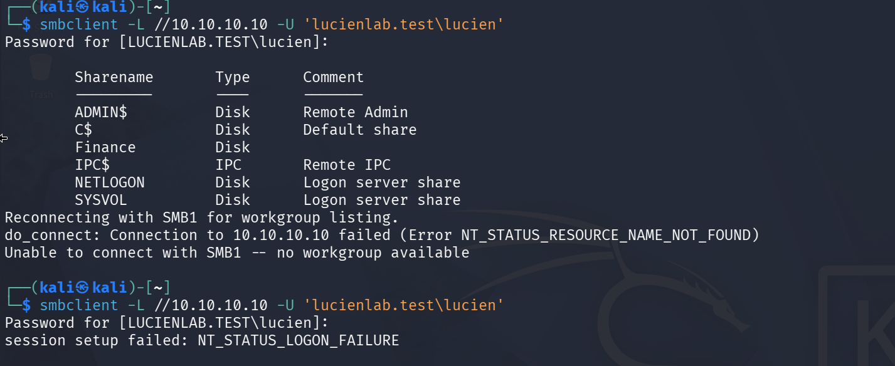
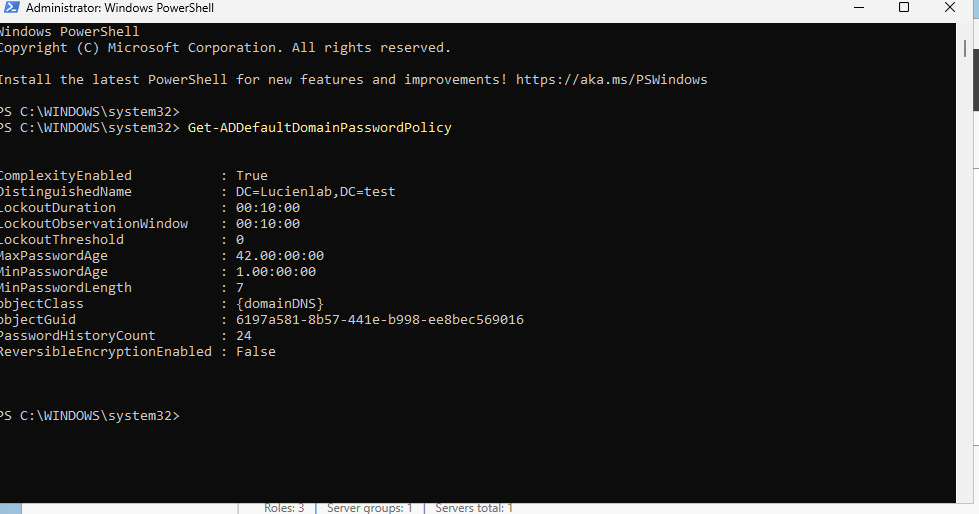
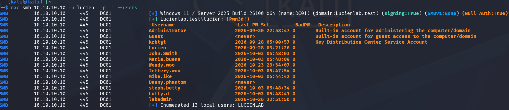
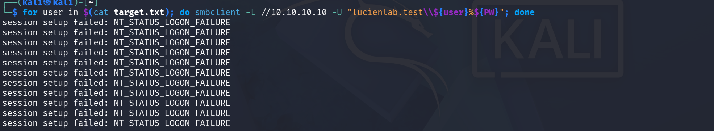
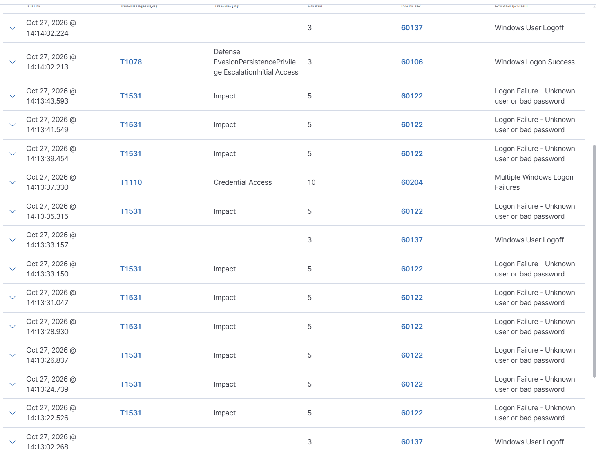
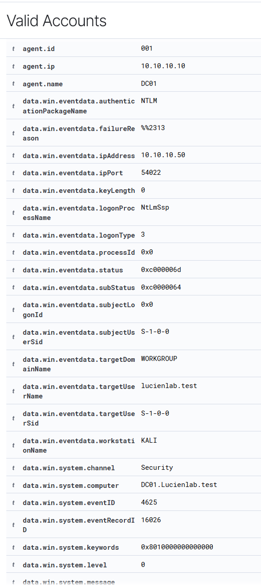
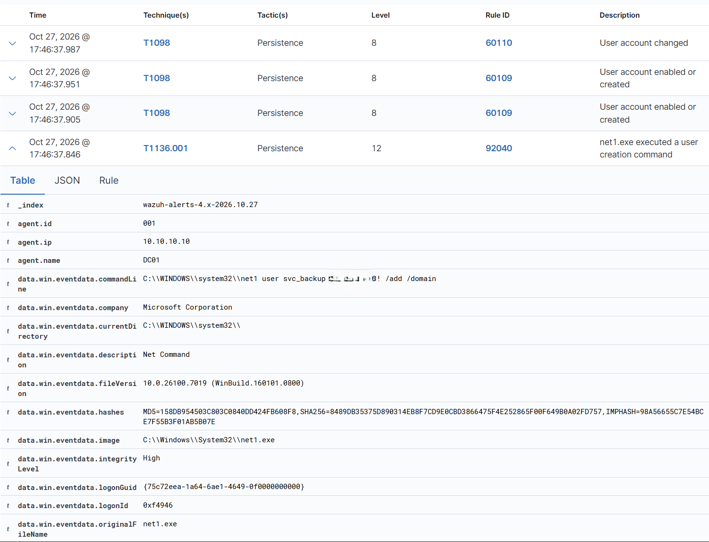
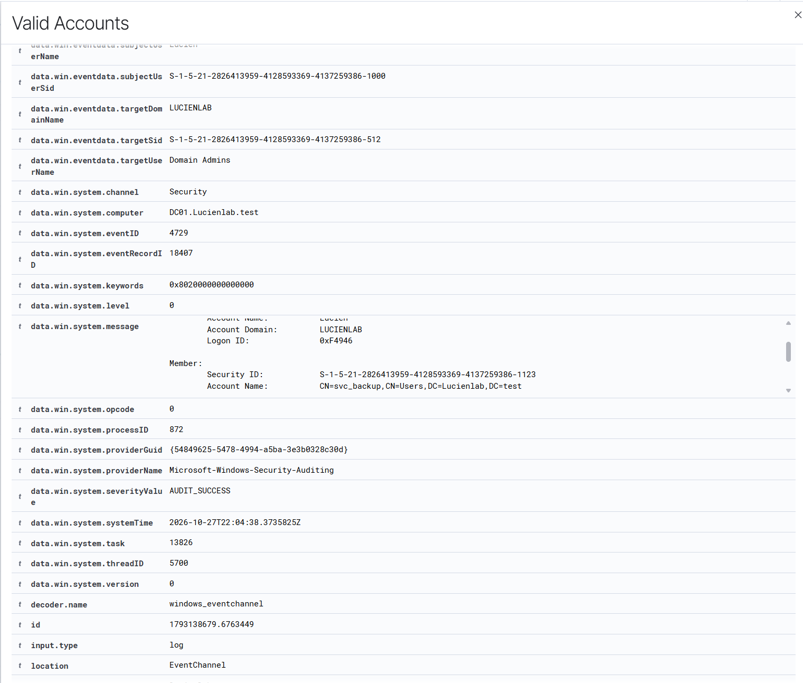
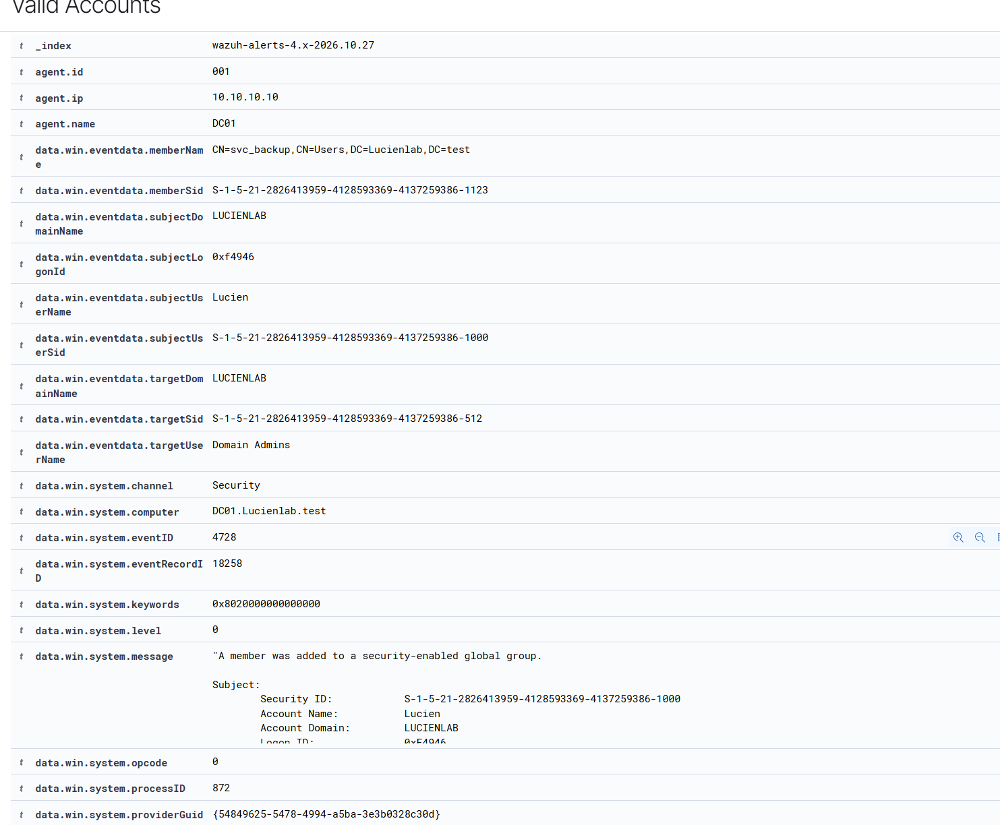

# Active Directory Attack → Detect → Document Lab

**Author:** Luis Felix
**Date:** October 27, 2026
**Environment:** Self-contained home lab (VMware Workstation, isolated host-only network)
**Role focus:** Blue team / SOC analyst — detection engineering and threat hunting

---

## Overview

This lab documents a controlled attack-and-detection exercise against an Active Directory domain I built and fully own. Working from an attacker machine (Kali), I executed a sequence of common AD attacks against a domain controller, then hunted each one in a Wazuh SIEM and documented the detections, the MITRE ATT&CK mapping, and the false positives I had to triage along the way.

The goal was not to "hack" anything — it was to understand **what each attack looks like from the defender's side**: which Windows events fire, which Wazuh rules catch them, how to tell real signal from noise, and how an analyst reconstructs what happened from the logs.

> **Scope / ethics:** Every system in this lab is owned by me and runs on an isolated host-only network (10.10.10.0/24) with no route to the internet or any third party. All activity was confined to that subnet.

---

## Lab Architecture

| Host | IP | OS | Role |
|---|---|---|---|
| DC01 | 10.10.10.10 | Windows Server 2025 | Domain Controller (`lucienlab.test`), Wazuh agent + Sysmon |
| WIN11-01 | 10.10.10.20 | Windows 11 | Domain-joined client, Wazuh agent + Sysmon |
| WAZUH01 | 10.10.10.30 | Ubuntu 24.04 | Wazuh 4.14 SIEM / dashboard |
| KALI | 10.10.10.50 | Kali Linux | Attacker |

All VMs were snapshotted at a clean "pre-attack" baseline so each round could be replayed from a known-good state.

### The detection pipeline

Every detection in this lab depends on one pipeline working end to end. Understanding it is what makes troubleshooting possible when an attack *doesn't* show up:

```
[Windows Security Log + Sysmon]  →  [Wazuh Agent]  →  [Wazuh Manager: decode + rules]  →  [Indexer]  →  [Dashboard]
   on DC01 / WIN11-01                port 1514/TCP       on WAZUH01                          OpenSearch      where I hunt
```

A detection can silently fail at any hop: the event never gets written (wrong audit policy), the agent isn't collecting that log channel, the agent is disconnected, or no rule fires. Pre-flight exists to prove every hop works *before* attacking — so that a later empty result points to the attack config, not a broken pipe.

<!-- SCREENSHOT: (optional) a diagram of the pipeline, or skip -->

---

## Pre-Flight: Validating the Pipeline

Before any attack, I confirmed the full logging chain was healthy.

**1. Agents active.** Confirmed DC01 and WIN11-01 both reported `Active` to the Wazuh manager (agent → manager channel on 1514 is up).

**2. Security channel collected.** Verified the Wazuh agent on DC01 was collecting the Windows **Security** channel (the source of event IDs 4625, 4720, 4728) and the Sysmon operational channel.

**3. Reachability.** From Kali, confirmed DC01 was reachable and exposing the expected DC ports (445 SMB, 88 Kerberos, 389/636 LDAP, etc.).

**4. End-to-end smoke test.** Sent a single deliberately-bad SMB authentication from Kali and confirmed the resulting failed logon appeared in the Wazuh dashboard — proving the pipeline worked from event to dashboard.


### Finding #1 — Blank-password domain account

During pre-flight I discovered a standard domain account had been configured (intentionally, as a planted misconfiguration) with a **blank password**. Share enumeration against the DC succeeded with no credentials supplied.

This is a genuine, serious misconfiguration: a single credential-less account hands an attacker the entire domain user roster (see Round 2), which is step one of any password-spray or targeted attack. It is logged as the first documented finding of the lab.

**Severity:** High. **Remediation:** Enforce a password on all accounts; audit for blank/weak passwords via the domain password policy.

---

## Tool Selection: NetExec (nxc) over SMB

For the password-spray round I chose **NetExec (`nxc`)** over SMB as the primary tool, with the following reasoning:

- The goal of Round 2 was to produce and hunt the classic **4625 failed-logon flood**, which an SMB spray generates directly.
- NetExec is the actively-maintained successor to CrackMapExec (which is effectively discontinued); `nxc` is the current command and what is seen in the field.
- Kerberos-based spraying with a tool like `kerbrute` produces *different* telemetry (event 4771 instead of 4625), which is a valuable contrast exercise reserved for a future session.

---

## Round 1 — Recon (Network Scan) and SIEM Blindness

**Attack:** Network port scan of DC01 from Kali (`nmap`).
**MITRE:** T1046 (Network Service Discovery) / T1595 (Active Scanning).

**Attacker view:** `nmap` returned the expected open DC ports (445/SMB, 88/Kerberos, 389/636/LDAP, 135/RPC, 3268/Global Catalog, 53/DNS).

**Defender view:** Essentially nothing. The host-based SIEM produced no meaningful alert for the scan itself.

### Finding #2 — Host-based SIEM is nearly blind to network scans

A host-based agent like Wazuh watches **logs on the host** — logons, process creation, account changes. A raw TCP port scan doesn't generate security-log events; it's network-layer activity the host doesn't meaningfully record. To detect scanning you need **network-layer visibility** (IDS/NIDS such as Suricata/Zeek, firewall logs, or NetFlow) — a different sensor class entirely.

This is the defining limitation of host-based detection, and it sets up the contrast with Round 3, where host + Sysmon telemetry proves *devastatingly* effective against on-box command execution. **Right tool, right layer.**


---

## Round 2 — Password Spray

**Attack:** One password sprayed across a list of enumerated domain users.
**MITRE:** **T1110.003** (Brute Force: Password Spraying).
**Source:** KALI (10.10.10.50) → **Target:** DC01 (10.10.10.10) over SMB.

### Step 1 — Checking the lockout policy (why this matters first)

Before spraying I pulled the domain password policy to avoid locking out accounts and burying the signal:

```powershell
Get-ADDefaultDomainPasswordPolicy
```

Result: **`LockoutThreshold: 0`**.

### Finding #3 — Account lockout is disabled

A threshold of `0` means **accounts never lock**, regardless of how many failed attempts occur. The `LockoutDuration` and `LockoutObservationWindow` values (10 minutes each) are parked and have no effect while the threshold is 0.

This is both a convenience (unlimited clean spray attempts for the lab) and a real-world finding: a domain with lockout disabled lets an attacker spray passwords indefinitely without tripping the one policy control designed to stop them.

**Severity:** Medium–High. **Remediation:** Set a lockout threshold (e.g., 5) with an appropriate observation window; monitor for 4740 (account lockout) events.



### Step 2 — Enumerating real usernames

Guessing usernames is unreliable — a wrong guess is indistinguishable in the logs from a non-existent user. Instead I used the blank-password account access (Finding #1) to pull the **real** domain accounts:

```bash
nxc smb 10.10.10.10 -u <blank-password-account> -p '' --users
```

This returned the true `sAMAccountName` for every account — confirming that several accounts I had guessed (e.g. `Danny.Phantom`) were actually stored differently (`Danny.phantom`), and surfacing accounts I didn't know existed, including a likely admin account (`labadmin`).

### Finding #4 — Credential-less user enumeration

The blank-password account allowed a full dump of the domain user list over MS-RPC/SAMR with no valid credentials. This demonstrates concretely *why* Finding #1 is dangerous: one weak account exposes the entire roster, which directly enables a targeted spray.



### Step 3 — The spray

I sprayed a single password across the 11 real accounts. (Tooling note below explains the delivery mechanism.) Every attempt failed as expected, producing a clean failed-logon flood.

**Attacker view:** 11 × `NT_STATUS_LOGON_FAILURE` — one per account. Every account existed; every password was rejected.



**Defender view (the three layers):**

| Rule | Event | Level | Meaning |
|---|---|---|---|
| 60122 (×11) | Security 4625 | 5 | Individual failed logons (atomic noise) |
| **60204 (×1)** | **Correlation** | **10** | **"Multiple Windows Logon Failures" — the spray detected as a pattern** |



### Finding #5 — Correlation is the real detection

Individual failed logons (60122) are meaningless on their own — people mistype passwords constantly. The value is in the **correlation rule (60204)**, which counted many failures from one source in a short window and fired a single higher-severity alert that says *"this is an attack, not noise."* This is the core concept of SIEM aggregation: the whole is more alarming than the sum of its parts.

### Finding #6 — Reading subStatus to profile the attacker

Expanding a 4625 event revealed:
- `status: 0xc000006d` (generic logon-failed wrapper — always present)
- **`subStatus: 0xc000006a`** (the field that actually talks)

The subStatus code tells an analyst *what kind* of attack this is:

| subStatus | Meaning | Analyst conclusion |
|---|---|---|
| `0xc0000064` | User does not exist | Attacker is guessing usernames (bad list) |
| **`0xc000006a`** | **User exists, wrong password** | **Attacker has VALID usernames, now working passwords** |

Because this spray showed `0xc000006a` across the board, the logs themselves reveal that the attacker had already enumerated valid accounts (Finding #4) and was working passwords — the more advanced and dangerous signal. Reading this one hex field is what distinguishes profiling an attacker from merely counting red events.



### Tooling note — isolating an nxc fault by layered testing

The spray did not run cleanly on the first attempt. `nxc` returned repeated `NETBIOS connection timed out` errors. Rather than guess, I diagnosed the path from attacker to target one layer at a time:

| Test | Result | Conclusion |
|---|---|---|
| `ping 10.10.10.10` | Replies | L3 reachable |
| `nmap -Pn -p 445` | `445 open` | SMB service up and answering |
| `smbclient` (wrong pw) | `NT_STATUS_LOGON_FAILURE` | SMB auth works — DC is healthy |
| `nxc` (same target) | `NETBIOS timed out` | **Fault is nxc-specific** |

Because `smbclient` succeeded against the identical target at the identical moment, the fault was isolated to `nxc`'s own SMB connection state (a known issue after its first-run initialization plus repeated half-open sessions), **not** the DC, the network, or the port. I completed the spray by building the attack from a primitive — a bash loop around `smbclient` — which produced the identical detection.

This layered isolation (ping → port → alternate tool → suspect tool) is the standard method for turning "it doesn't work" into an actionable diagnosis, and is itself a core analyst skill.

---

## Round 3 — Post-Exploitation: Persistence via a Rogue Domain Admin

**Attack:** Create a new domain account and add it to Domain Admins — a hidden backdoor that survives a password reset of the originally-compromised account.
**MITRE:** **T1136** (Create Account) + **T1098 / T1484** (Account Manipulation / Domain Policy Modification for privilege escalation).
**Executed on:** DC01 directly (living-off-the-land with built-in `net` commands — no malware required).

### Part A — Account creation

```cmd
net user svc_backup <password> /add /domain
```

The account name `svc_backup` was chosen deliberately to blend in with legitimate service accounts — a tired admin scrolling the user list skims past it. Same detection fires regardless of name, but the choice is itself a tradecraft point.

**Defender view — caught three ways simultaneously:**

| Rule | Source | Level | What it tells you |
|---|---|---|---|
| **92040** | **Sysmon (process creation)** | **12** | Captured the **full command line**: `net1 user svc_backup <password> /add /domain` |
| 60109 | Security 4720 | 8 | Account created/enabled |
| 60110 | Security 4738 | 8 | Account properties changed |



### Finding #7 — Account-management events, not logon events

Creating an account produces **account-management** events (4720/4738), **not** logon events (4624/4625) — because no authentication occurs. Recognizing which audit category an action lands in is fundamental to knowing where to hunt.

### Finding #8 — Two sensors, two stories (the value of Sysmon)

This round demonstrates why the lab runs Sysmon alongside the native Security log:

- **Security log (4720)** tells you the **outcome** — *an account named `svc_backup` was created.*
- **Sysmon (process creation)** tells you the **action** — *it was created via `net1.exe`, from an elevated shell (`integrityLevel: High`), with the full command line and even the binary's hashes for threat-intel lookup.*

A complete investigation needs both: the Security log proves *what* exists, Sysmon proves *how* it got there. (Note: `net.exe` silently hands off to `net1.exe`, so Sysmon logs `net1` — detection rules that only watch `net.exe` miss this.)

### Part B — Privilege escalation

```cmd
net group "Domain Admins" svc_backup /add /domain
```

A standard user is harmless; the moment it joins **Domain Admins**, it becomes a privileged, persistent backdoor.

**Defender view:**

| Rule | Event | Level | Meaning |
|---|---|---|---|
| **60159** | **Security 4728** | **12** | **"Domain Admins Group Changed" — the high-value override rule** |
| 60148 | Security 4728 | 5 | "Security Enabled Global Group Changed" — generic baseline rule |





### Finding #9 — Full attribution from a single 4728 event

The 4728 event is a complete investigative record:
- **Actor:** `Lucien` (subjectSid ending `-1000`) — *who performed the action*
- **Member added:** `svc_backup` (memberSid ending `-1123`)
- **Group:** Domain Admins (targetSid ending **`-512`** — the universal, well-known RID for Domain Admins on every Windows domain)

One event answers *who, what, which group, and when* — enabling an analyst to trace the action back to the compromised account.

### Finding #10 — Specific rules override generic rules for crown-jewel targets

Both 60159 (L12) and 60148 (L5) match the *same* 4728 event. The ruleset applies a generic baseline (any group change = L5) plus a sharp high-severity override when the target is specifically **Domain Admins** (L12). Well-designed detection escalates the crown jewels above background noise.

### The complete kill chain detected

| Time | Event | Rule | Attacker action |
|---|---|---|---|
| 17:46 | 4720 | 60109 (L8) | Created `svc_backup` |
| 17:46 | Sysmon proc | 92040 (L12) | …via `net1 user … /add` (full command captured) |
| 17:54 | 4728 | **60159 (L12)** | Added it to Domain Admins |

Create → elevate → persist. Every stage individually logged and detected.

---

## False Positives and Rule Tuning

A major outcome of this lab was learning to triage a noisy custom ruleset against **ground truth** — the single most important SOC skill. Several alarming alerts were confirmed benign:

| Rule | Alarming label | Reality | Why it's a false positive |
|---|---|---|---|
| 92657 | Pass-the-Hash (T1550.002) | Legitimate credentialed logon | Fired on a normal successful NTLM logon to the DC; no hash was passed |
| 92652 | Pass-the-Hash via ANONYMOUS LOGON | Benign null session | Anonymous logon is the *opposite* of PtH — no credential exists at all; triggered by allowed null sessions |
| 92307 | New service creation (T1543.003) | Normal Windows per-user services | `svchost.exe -k` instances (e.g. `DevicePickerUserSvc`) spun up at logon — signed Microsoft binaries in `system32` |
| 92213 | Executable dropped in malware folder (T1105, L15) | My own tooling | PowerShell/attacker activity, reconciled against "what was I doing at that timestamp" |
| 60122 | Impact / T1531 (Account Access Removal) | Password spray | The atomic failed-logon rule mis-maps to T1531; the correct technique for the pattern is T1110 (correctly applied by the 60204 correlation rule) |

### Finding #11 — The "was that me?" reflex

The recurring lesson across every false positive: **reconcile every scary alert against known activity before escalating.** A Level-15 "executable dropped" alert that coincides exactly with my own PowerShell session is almost certainly my own tooling, not an intrusion. This triage judgment — ground truth beats the heuristic — is the bulk of a SOC analyst's actual work. The MITRE tag a rule auto-assigns is a starting point, not a verdict.

---

## Cleanup

The rogue Domain Admin account is a real backdoor and was removed after the exercise:

```cmd
net group "Domain Admins" svc_backup /delete /domain
net user svc_backup /delete /domain
```

Deletion itself is detectable — removing the account throws **4726** (user deleted) and removing it from the group throws **4729** (member removed from group) — closing the loop by detecting my own cleanup. VMs were then rolled back to a clean snapshot.

---

## Summary of Findings

| # | Finding | Severity |
|---|---|---|
| 1 | Domain account `lucien` has a blank password | High |
| 2 | Host-based SIEM nearly blind to network scans (needs network-layer sensor) | Informational |
| 3 | Account lockout disabled (`LockoutThreshold: 0`) | Medium–High |
| 4 | Credential-less user enumeration possible via the blank-password account | High |
| 5 | Password spray detected by correlation rule (60204), not atomic events | — (detection win) |
| 6 | subStatus `0xc000006a` reveals attacker has valid usernames | — (hunting technique) |
| 7–10 | Rogue Domain Admin created + detected across Sysmon and Security log | — (detection win) |
| 11 | Multiple false positives in the custom ruleset require tuning | Medium |

## Key Takeaways

- **The pipeline is everything.** Validate event → agent → manager → dashboard before attacking, so an empty result means a config problem, not a broken pipe.
- **Ground truth beats the heuristic.** Most "critical" alerts in a noisy ruleset are false positives; triage against known activity first.
- **Correlation > atomic events.** The spray mattered because a correlation rule saw the pattern, not because of any single failed logon.
- **Read the fields, not just the rule name.** subStatus codes, well-known RIDs (512 = Domain Admins), and the `subject` (actor) fields turn a row of red into a reconstructed attack.
- **Match the sensor to the layer.** Host + Sysmon is blind to port scans but devastating against on-box command execution.
- **Diagnose by isolation.** When a tool fails, test each layer (ping → port → alternate tool) rather than guessing.

---

## Future Work

- **Kerberoasting (T1558.003):** request service tickets, crack them *offline* with John — and confirm the crack produces **no DC logs**, in contrast to the loud online spray.
- **kerbrute contrast:** spray Kerberos pre-auth to observe 4771 instead of 4625.
- **Network-layer detection:** add Suricata/Zeek to catch the Round 1 scan that host-based Wazuh missed.
- **Rule tuning:** suppress the false positives catalogued above to reduce analyst alert fatigue.
